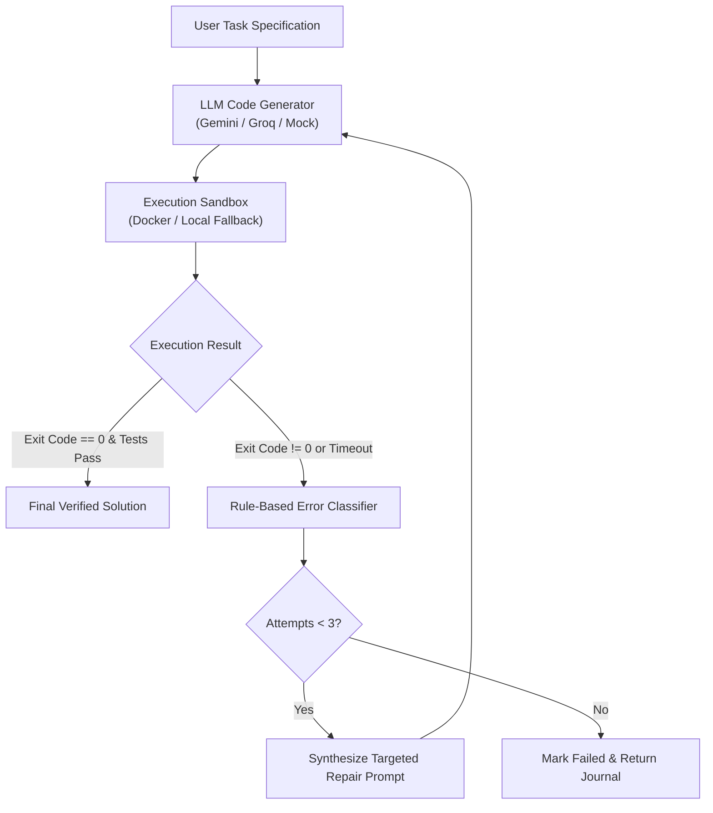

# CodeForge

> **Autonomous Coding Agent with Docker-Sandboxed Execution and Bounded Self-Repair**

[](https://www.typescriptlang.org/)
[](https://react.dev/)
[](https://nodejs.org/)
[](https://www.docker.com/)
[](LICENSE)

---

## 📌 Table of Contents

- [Overview](#-overview)
- [How CodeForge Works (Agent Lifecycle)](#-how-codeforge-works-agent-lifecycle)
- [Key Features](#-key-features)
- [Architecture & Tech Stack](#-architecture--tech-stack)
- [Project Directory Structure](#-project-directory-structure)
- [Security & Sandbox Isolation](#-security--sandbox-isolation)
- [Getting Started](#-getting-started)
  - [Prerequisites](#prerequisites)
  - [1. Clone Repository](#1-clone-repository)
  - [2. Environment Configuration](#2-environment-configuration)
  - [3. Backend Setup](#3-backend-setup)
  - [4. Frontend Studio Setup](#4-frontend-studio-setup)
  - [5. Running via Docker Compose](#5-running-via-docker-compose)
- [Testing & Quality Assurance](#-testing--quality-assurance)
- [Benchmark Framework](#-benchmark-framework)
- [WebSocket & API Reference](#-websocket--api-reference)
- [Deployment Guide](#-deployment-guide)
- [Contributing](#-contributing)
- [License](#-license)

---

## 🚀 Overview

**CodeForge** is an autonomous coding agent platform that bridges the gap between raw LLM code generation and reliable, production-ready execution. 

Instead of treating LLM output as a one-shot miracle, CodeForge runs generated Python code in an isolated, resource-constrained execution sandbox, inspects the stdout/stderr stream, classifies runtime failures via a structured taxonomy, and autonomously repairs the solution through a closed feedback loop (up to 3 attempts).

### 🎯 Core Principles
1. **Never trust generated code**: All execution happens in locked-down environments (Docker containers with dropped privileges, zero network access, and strict cgroups).
2. **Deterministic error classification**: Instead of feeding raw traceback spam back to the LLM, errors are parsed into discrete categories (`SyntaxError`, `MissingDependency`, `Timeout`, `PermissionDenied`, etc.) with actionable guidance.
3. **Live observability**: Operators track every generation step, execution attempt, and sandbox log in real time through WebSocket streaming.

---

## 🔄 How CodeForge Works (Agent Lifecycle)



1. **Task Ingestion**: The user submits a natural-language programming prompt or task brief.
2. **Code Generation**: The orchestrator invokes the configured LLM provider (**Google Gemini 2.0 Flash** primary, with automatic fallback to **Groq Llama 3.3 70B** or a deterministic offline mock).
3. **Sandboxed Execution**: Code is executed inside an ephemeral container or isolated subprocess with hard limits on memory (512MB), CPU (1 core), PIDs (64), and execution time (15s).
4. **Structured Error Classification**: If execution fails, the classifier parses tracebacks, exits, or timeouts to determine the exact failure mode.
5. **Bounded Self-Repair**: The agent generates an amended program guided by the classified failure context.
6. **Telemetry & Verification**: Every step is emitted via WebSockets to the React Studio frontend and persisted to PostgreSQL.

---

## ✨ Key Features

- **🤖 Autonomous Self-Repair Loop**: Automatically detects syntax, logic, and runtime errors and self-repairs code within 3 attempts.
- **🛡️ Secure Docker Sandbox**:
  - `NetworkMode: none` (prevents external data exfiltration and SSRF).
  - Unprivileged execution under user `nobody` (`uid: 65534`).
  - Read-only code mount with temporary memory-capped `tmpfs`.
  - Dropped Linux capabilities (`CapDrop: ALL`) and `no-new-privileges`.
- **⚡ Dual LLM Provider Fallback**: Seamless multi-provider reliability with Gemini and Groq, plus cassette recording/replay for offline CI testing.
- **📊 Real-Time Studio UI**:
  - Live execution journal and terminal streaming over WebSockets.
  - Interactive multi-attempt cards with visual code diffs.
  - Success rate, attempt distributions, and error-category metrics.
- **📈 Built-In Benchmark Suite**: 25-task automated evaluation harness to measure Pass@1, Pass@3, and self-repair convergence rates.
- **🔒 Production Security**: Built-in rate limiting, Helmet HTTP security headers, CORS origin enforcement, body size caps, and API token quota enforcement.

---

## 🛠️ Architecture & Tech Stack

| Layer | Technologies |
| :--- | :--- |
| **Frontend Studio** | React 18, Vite, TypeScript, Tailwind CSS, Lucide React, Wouter |
| **Backend Orchestrator** | Node.js 20+, Express, TypeScript, ts-node-dev |
| **Real-Time Streaming**| Socket.io (client & server) |
| **Execution Sandboxes** | Dockerode (Docker Engine API), Python 3.12 slim, Local Subprocess Runner |
| **LLM Integrations** | Google Gemini API (`gemini-2.0-flash`), Groq API (`llama-3.3-70b-versatile`) |
| **Persistence** | PostgreSQL (`pg`), in-memory fallback |
| **Testing & Benchmark** | ts-node custom test harness, automated benchmark runner |

---

## 📂 Project Directory Structure

```text
CodeForge/
├── client/                     # React + Vite Frontend Studio
│   ├── public/                 # Static assets and icons
│   ├── src/                    # UI components, contexts, and hooks
│   ├── .env.example            # Frontend environment configuration
│   ├── package.json            # Frontend dependencies
│   └── vite.config.ts          # Vite configuration
│
├── server/                     # Backend API & Agent Orchestrator
│   ├── src/
│   │   ├── agents/             # Agent orchestration and execution state machines
│   │   ├── audit/              # Audit logging and quota enforcement
│   │   ├── classifier/         # Rule-based error categorization engine
│   │   ├── config/             # Environment validation and settings
│   │   ├── controllers/        # Express HTTP route controllers
│   │   ├── database/           # PostgreSQL connection and migrations
│   │   ├── evaluation/         # Automated validation and verification checks
│   │   ├── llm/                # Multi-provider LLM clients (Gemini, Groq, Mock)
│   │   ├── sandbox/            # Docker container & local subprocess executors
│   │   ├── websocket/          # Socket.io event dispatchers and log streamers
│   │   └── server.ts           # Server entry point
│   ├── src/__tests__/          # Unit, integration, and security test suites
│   ├── .env.example            # Backend environment template
│   └── package.json            # Backend scripts and dependencies
│
├── benchmark/                  # 25-task evaluation framework
│   ├── cases/                  # Test scenarios and validation suites
│   ├── tasks/                  # Task definitions (JSON)
│   ├── runner.ts               # Automated benchmark execution engine
│   └── report.md               # Generated performance and reliability report
│
├── docker/                     # Dockerfiles for backend and sandbox environments
├── docker-compose.yml          # Containerized backend setup
├── DEPLOY.md                   # Cloud production deployment instructions
├── SECURITY.md                 # Detailed threat model and sandbox isolation audit
└── README.md                   # Project documentation
```

---

## 🛡️ Security & Sandbox Isolation

CodeForge treats all generated code as potentially malicious untrusted input. The sandbox implements multi-layer defense-in-depth:

| Threat | Sandbox Defense |
| :--- | :--- |
| **Data Exfiltration / SSRF** | `NetworkMode: none` in Docker container |
| **Privilege Escalation** | Runs as user `nobody` (uid 65534), `CapDrop: ALL`, `no-new-privileges` |
| **CPU / Resource Starvation** | Strict cgroup limit: 1 core (`NanoCpus`), 64 PID limit |
| **Memory Exhaustion (OOM)** | Hard 512 MB memory boundary |
| **Filesystem Tampering** | Read-only mount of user script; temporary storage is size-capped `tmpfs` |
| **Infinite Loops / Hangs** | Strict wall-clock kill timeout (default 15 seconds) |
| **Secret Leaks** | Host environment variables (e.g. `GEMINI_API_KEY`) are never passed to the sandbox |

---

## 🏁 Getting Started

### Prerequisites

- **Node.js**: `v20.x` or higher ([Node.js Official Downloads](https://nodejs.org/))
- **Docker Desktop** (optional, recommended for secure execution): ([Docker Get Started](https://www.docker.com/get-started/))
- **Python**: `3.10+` (required if running in local sandbox fallback mode)
- **Git**

---

### 1. Clone Repository

```bash
git clone https://github.com/parulgupta-afk/CodeForge.git
cd CodeForge
```

---

### 2. Environment Configuration

#### Backend Setup (`server/.env`)
Copy the template and configure your API keys:
```bash
cp server/.env.example server/.env
```

Key environment options in `server/.env`:
```ini
# Provide at least one API key (or set USE_MOCK_LLM=true for offline testing)
GEMINI_API_KEY=your_gemini_api_key_here
GEMINI_MODEL=gemini-2.0-flash

# Fallback provider
GROQ_API_KEY=your_groq_api_key_here
GROQ_MODEL=llama-3.3-70b-versatile

# Server configuration
PORT=3001
CORS_ORIGIN=http://localhost:5173

# Sandbox configuration
USE_DOCKER=false         # Set to true when Docker daemon is running
SANDBOX_MODE=dev         # 'dev' falls back to local subprocess if Docker is offline
```

#### Frontend Setup (`client/.env`)
```bash
cp client/.env.example client/.env
```

Ensure `client/.env` points to the backend server:
```ini
VITE_WS_URL=http://localhost:3001
```

---

### 3. Backend Setup

```bash
cd server
npm install
npm run dev
```
> Backend API and WebSocket hub will listen on `http://localhost:3001`.

---

### 4. Frontend Studio Setup

In a separate terminal:
```bash
cd client
npm install
npm run dev
```
> Open your browser and navigate to `http://localhost:5173`.

---

### 5. Running via Docker Compose

To launch the backend service with Docker Compose:

```bash
docker compose up --build
```

---

## 🧪 Testing & Quality Assurance

CodeForge includes comprehensive test suites covering the error classifier, agent orchestrator, provider fallback mechanism, sandboxes, and security boundaries.

Run all server tests:
```bash
cd server
npm test
```

Run targeted test suites:
```bash
npm run test:classifier     # Test traceback parsing & categorization
npm run test:orchestrator   # Test agent state-machine & repair cycle
npm run test:providers      # Test Gemini/Groq fallback handling
npm run test:sandbox        # Test local subprocess isolation & timeouts
npm run test:security       # Test abuse prevention, quotas, & boundary checks
```

---

## 📊 Benchmark Framework

The repository contains an automated 25-task evaluation suite in `/benchmark` measuring real-world code generation and repair reliability across Math, Algorithms, Data Processing, and String Manipulation.

To run the benchmark suite against a running server:

```bash
cd benchmark
npm install
npx ts-node runner.ts
```

Benchmark output generates a structured JSON report (`benchmark/results.json`) and Markdown summary (`benchmark/report.md`):

| Metric | Target |
| :--- | :--- |
| **Pass@1 Rate** | Percentage of tasks solved on the first attempt |
| **Pass@3 Rate** | Cumulative percentage of tasks solved within 3 attempts |
| **Self-Repair Rate** | Percentage of failed initial attempts successfully fixed |
| **Error Distribution**| Categorized breakdown of initial failure modes |

---

## 📡 WebSocket & API Reference

### REST Endpoints
- `GET /api/health`: Health-check endpoint verifying LLM connectivity and sandbox status.
- `POST /api/runs`: Submits a new coding task specification.
- `GET /api/runs/:id`: Fetches task status, attempt journals, and code outputs.
- `GET /api/stats`: Returns aggregate metrics (total runs, pass rates, error taxonomy).

### Real-Time WebSocket Events (`Socket.io`)

| Event Name | Direction | Description |
| :--- | :--- | :--- |
| `run:start` | Server ➔ Client | Emitted when a run begins processing |
| `run:step` | Server ➔ Client | Progress updates (`planning`, `generating`, `executing`, `repairing`) |
| `run:log` | Server ➔ Client | Live stdout/stderr streaming from the execution sandbox |
| `run:attempt` | Server ➔ Client | Summary of each attempt (code, status, classified error) |
| `run:complete` | Server ➔ Client | Final result payload with execution status and metrics |

---

## 🚢 Deployment Guide

For full production deployment instructions, see [DEPLOY.md](DEPLOY.md).

- **Client**: Optimized for deployment on [Vercel](https://vercel.com/) or [Netlify](https://www.netlify.com/). Set `VITE_WS_URL` to your production backend URL.
- **Backend**: Deploy on [Render](https://render.com/), [Fly.io](https://fly.io/), or a dedicated VPS. If deploying on a platform without access to the Docker daemon, keep `USE_DOCKER=false` to utilize the local process runner with timeouts.
- **Database**: Connect any managed PostgreSQL instance (e.g. Neon, Supabase, AWS RDS) by setting `DATABASE_URL`.

---

## 🤝 Contributing

Contributions, issues, and feature requests are welcome!

1. Fork the repository
2. Create your feature branch (`git checkout -b feature/AmazingFeature`)
3. Commit your changes (`git commit -m 'feat: implement amazing feature'`)
4. Push to the branch (`git push origin feature/AmazingFeature`)
5. Open a Pull Request

---

## 📄 License

Distributed under the **MIT License**. See `LICENSE` for more information.
